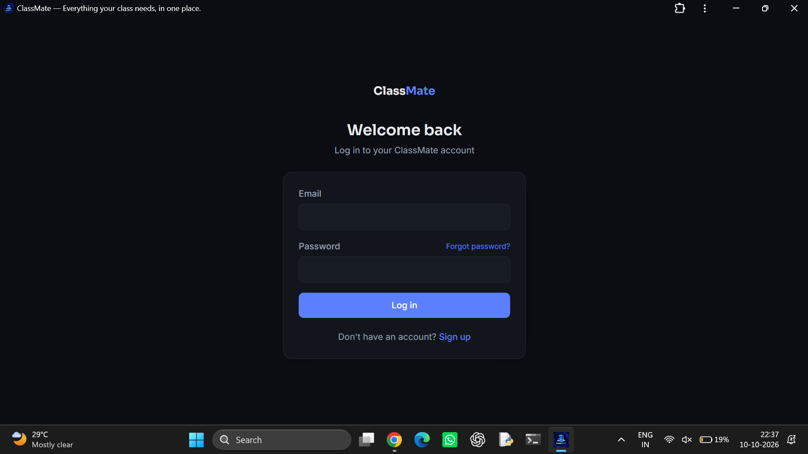
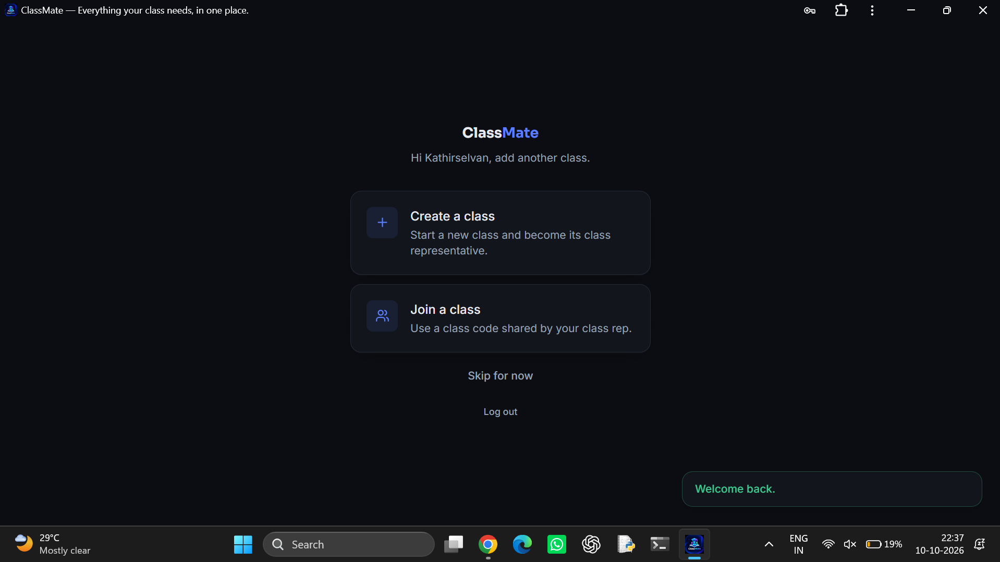
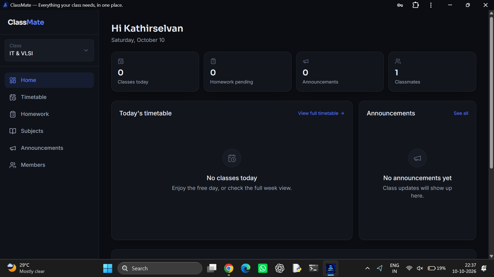
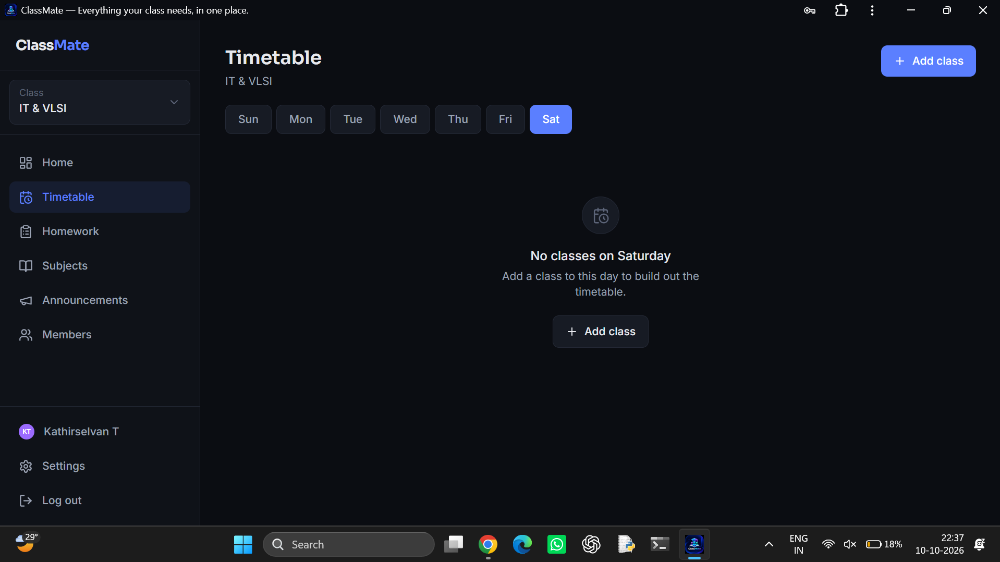
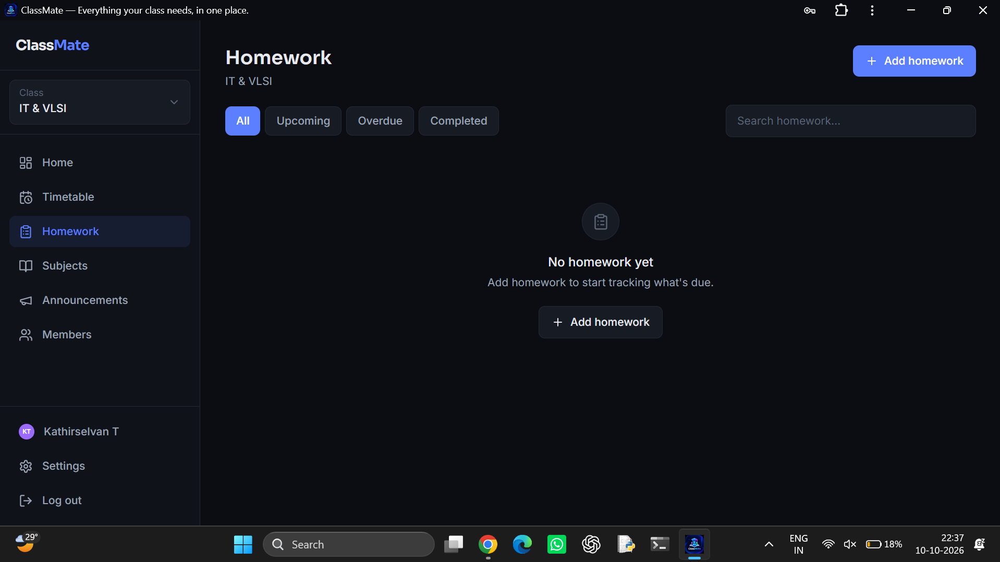
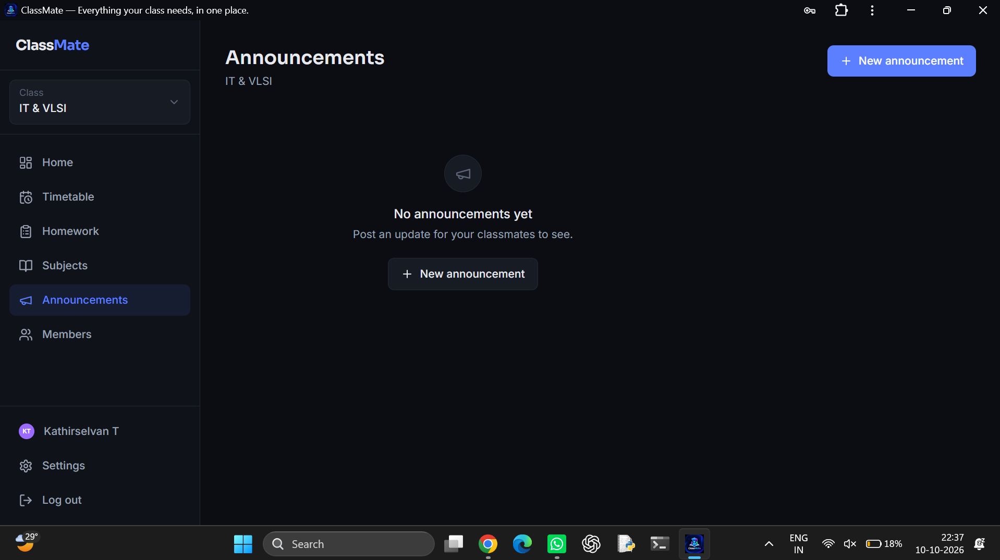

# ClassMate

<div align="center">

### Everything your class needs, in one place.

A student-focused class management platform to bring timetables, homework, subjects, and class announcements together in one workspace.

<p>
  <a href="https://classmate-7181.onrender.com/"><strong>🚀 Live Demo</strong></a>
  &nbsp;·&nbsp;
  <a href="https://github.com/kathir165/Classmate"><strong>📦 Source Code</strong></a>
</p>


</div>

---

## Preview

**Try the deployed application:** [classmate-7181.onrender.com](https://classmate-7181.onrender.com/)

<p align="center">
  <a href="https://classmate-7181.onrender.com/">
    
  </a>
</p>

### Application Screenshots

<p align="center">
  
  
</p>
<p align="center"><em>Login and onboarding</em></p>

<p align="center">
  
</p>
<p align="center"><em>Dashboard</em></p>

<p align="center">
  
  
</p>
<p align="center"><em>Timetable and homework</em></p>

<p align="center">
  
</p>
<p align="center"><em>Class announcements</em></p>

## About

ClassMate is a full-stack class-management web app designed to make everyday academic coordination simpler. Students can create a class, invite classmates with a class code, and keep important class information organized in one place.

## Features

- **Authentication** — account registration, login, and password recovery entry point.
- **Class spaces** — create a class or join an existing class using a shared code.
- **Dashboard** — get an overview of class activity and upcoming work.
- **Timetable** — organize classes by day and time.
- **Homework tracking** — search assignments and filter by status.
- **Subjects** — keep class subjects organized.
- **Announcements** — share updates with classmates.
- **Member management** — view class members and class participation.
- **Profile and settings** — access account preferences.
- **Responsive dark interface** — clear navigation with blue accents.

## Tech Stack

<div align="center">

### Frontend

<a href="https://react.dev/"></a>
<a href="https://www.typescriptlang.org/"></a>
<a href="https://vitejs.dev/"></a>
<a href="https://tailwindcss.com/"></a>

### Backend and data

<a href="https://nodejs.org/"></a>
<a href="https://expressjs.com/"></a>
<a href="https://www.postgresql.org/"></a>
<a href="https://orm.drizzle.team/"></a>
<a href="https://zod.dev/"></a>

### Deployment and services

<a href="https://render.com/"></a>
<a href="https://supabase.com/"></a>

</div>

| Layer | Technology |
|---|---|
| Frontend | React, TypeScript, Vite, Tailwind CSS |
| Backend | Node.js, Express, TypeScript |
| Database | PostgreSQL |
| ORM | Drizzle ORM |
| Authentication | JWT and bcrypt |
| Validation | Zod |
| Hosting | Render |

## Project Structure

```text
Classmate/
├── backend/
│   ├── src/
│   │   ├── db/             # Database schema and connection
│   │   ├── middleware/     # Authentication and authorization
│   │   ├── routes/         # API routes
│   │   └── index.ts        # Express entry point
│   ├── drizzle.config.ts
│   └── .env.example
└── frontend/
    ├── src/
    │   ├── components/     # Shared UI components
    │   ├── context/        # Application state providers
    │   ├── lib/            # API client and shared types
    │   └── pages/          # Application pages
    └── .env.example
```

## License and Copyright

Copyright © 2026 Kathirselvan T. All rights reserved.

This repository is public for viewing purposes only. No license or permission is granted to use, copy, modify, distribute, publish, or commercially exploit this code without prior written permission from the copyright holder. See [LICENSE](LICENSE) for the full notice.

---

<div align="center">

**ClassMate** — helping classmates stay organized, together.

</div>
